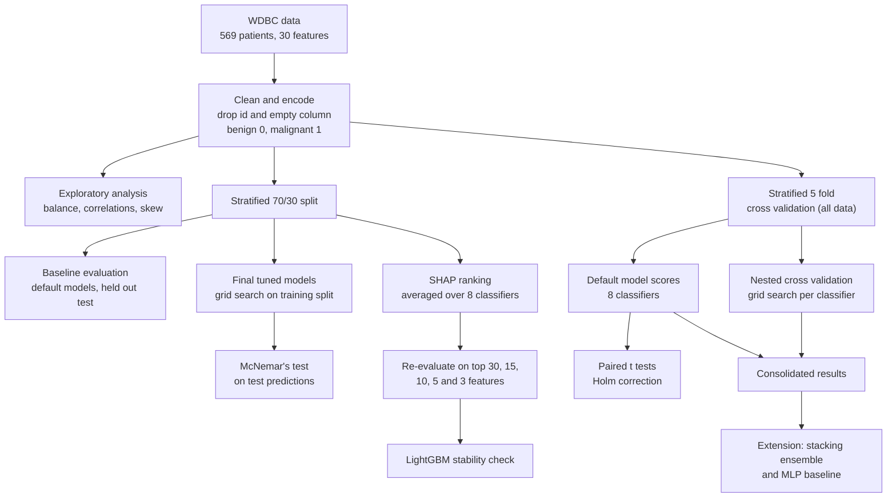
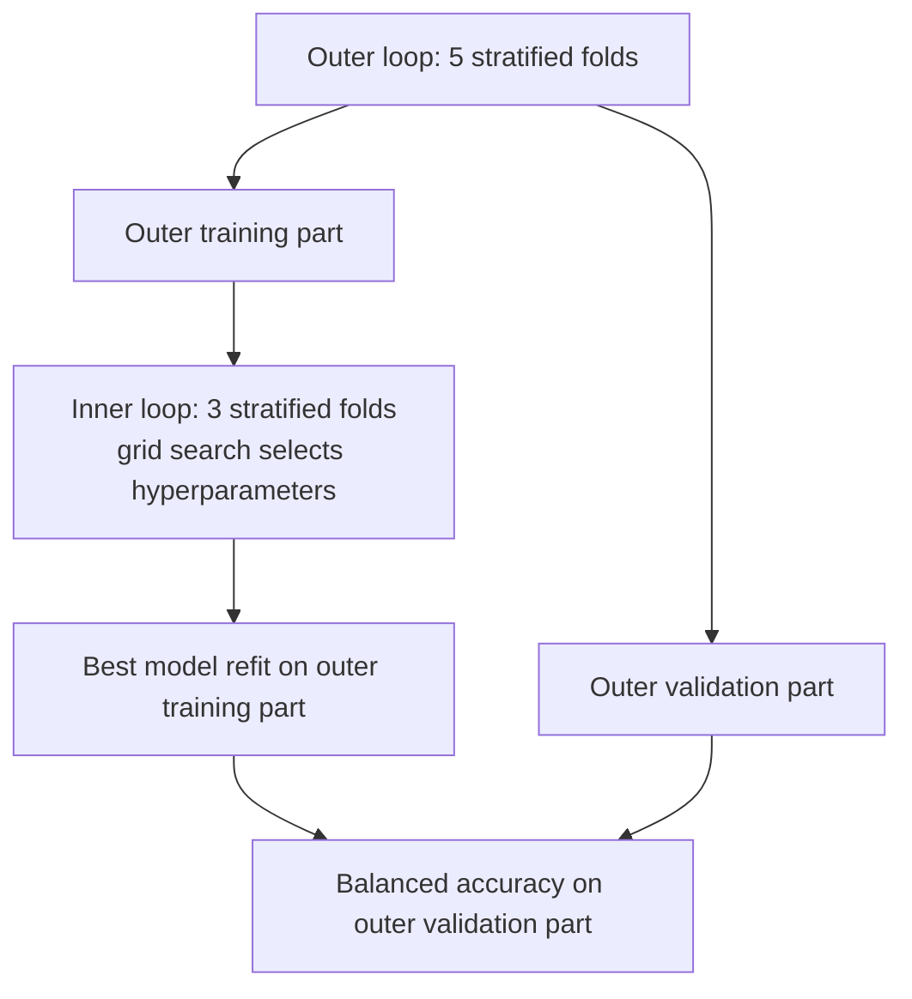

# Breast Cancer Diagnosis Classification on the Wisconsin Diagnostic Dataset (WDBC)

A reproducible comparison of eight machine learning classifiers for diagnosing breast tumours as benign or malignant. The project extends a published study (La Moglia and Almustafa, 2025) by running the full pipeline on a larger dataset and adding cross validation, nested hyperparameter tuning, significance testing, SHAP based feature selection and a stability check for LightGBM.

The whole analysis is in one notebook, [`notebooks/breast-cancer-classification-wdbc.ipynb`](notebooks/breast-cancer-classification-wdbc.ipynb).

> This is a research and learning project. It is not a medical device and must not be used for clinical decisions.

## Highlights

- **Larger, cleaner data.** WDBC has 569 patients (357 benign, 212 malignant) and 30 numeric features, almost three times the size of the clinical dataset used in the reference study, with no missing values.
- **Eight classifiers on the same pipeline.** Logistic Regression, Random Forest, Extra Trees, XGBoost, LightGBM, CatBoost, SVC and Gaussian Naive Bayes, each inside a pipeline with imputation and scaling.
- **Honest model selection.** Stratified 5 fold cross validation, and grid search inside nested cross validation so that tuning never sees the folds used for scoring.
- **Statistical testing.** Paired t tests with Holm correction and McNemar's test compare every pair of classifiers.
- **Explainability.** SHAP values averaged across all classifiers rank the features, and every classifier is re evaluated on 30, 15, 10, 5 and 3 features.
- **Runs on CPU.** The saved Kaggle run finished in about 13 minutes with no GPU.

## Pipeline architecture



### Model pipeline and nested cross validation




## Method

| Step | What happens |
|---|---|
| Cleaning | Drop the patient `id` and the empty trailing column, encode the target (`B` is 0, `M` is 1) |
| Exploration | Class balance, correlation heatmap, feature distributions by class, skewness |
| Split | Stratified 70/30 split with `random_state=42` |
| Baseline | Default hyperparameters, classification report, confusion matrices, precision recall and ROC curves |
| Cross validation | Stratified 5 fold on all patients. Balanced accuracy, recall, precision, F1 and ROC AUC |
| Tuning | Grid search with an inner 3 fold loop inside an outer 5 fold loop, scored by balanced accuracy |
| Significance tests | Paired t tests on per fold scores (Holm corrected) and McNemar's test on test predictions |
| Feature selection | Mean absolute SHAP values, averaged over all classifiers, then cross validation on the top N features |
| LightGBM check | Default and tuned LightGBM across feature counts |
| Extension | Stacking of the three best tuned models, plus an MLP baseline |

## Results from the saved run

Balanced accuracy from 5 fold cross validation (mean, with standard deviation across folds in brackets). "Tuned" scores come from nested cross validation.

| Classifier | Default | Tuned (nested) |
|---|---|---|
| SVC | **0.9732** (0.0201) | 0.9690 (0.0240) |
| Logistic Regression | 0.9676 (0.0234) | 0.9676 (0.0234) |
| CatBoost | 0.9616 (0.0146) | 0.9581 (0.0170) |
| Extra Trees | 0.9591 (0.0198) | 0.9544 (0.0206) |
| LightGBM | 0.9586 (0.0188) | 0.9610 (0.0110) |
| Random Forest | 0.9503 (0.0186) | 0.9479 (0.0181) |
| XGBoost | 0.9489 (0.0139) | 0.9530 (0.0287) |
| Gaussian Naive Bayes | 0.9220 (0.0196) | 0.9220 (0.0196) |

**Main findings**

- **Tuning made little difference.** No classifier changed by more than 0.005 once tuning was evaluated with nested cross validation.
- **The top models are statistically tied.** None of the 28 paired t tests was significant after Holm correction. McNemar's test (uncorrected) flagged 6 pairs, and in each the weaker model was Extra Trees or Gaussian Naive Bayes.
- **A few features carry most of the signal.** The highest averaged SHAP values are `perimeter_worst`, `concave points_worst` and `concave points_mean`.
- **Fewer features cost little down to five.**

| Features kept | 30 | 15 | 10 | 5 | 3 |
|---|---|---|---|---|---|
| SVC | 0.9732 | 0.9695 | 0.9742 | 0.9666 | 0.9294 |
| Logistic Regression | 0.9676 | 0.9756 | 0.9644 | 0.9609 | 0.9309 |

- **LightGBM is stable on this dataset.** Default scores stay between 0.949 and 0.959 from 30 down to 5 features and fall to 0.920 at 3 features.
- **Extension.** Stacking SVC, Logistic Regression and LightGBM reached 0.9737, a negligible gain over SVC alone. The MLP baseline scored 0.9634.

## Repository contents

```
.
├── notebooks/
│   └── breast-cancer-classification-wdbc.ipynb   # full analysis
└── README.md
```

## Getting started

### Run on Kaggle (recommended)

1. **Import the notebook.** In Kaggle, choose File, then Import Notebook, and upload `notebooks/breast-cancer-classification-wdbc.ipynb`.
2. **Add the data.** Use Add Data and attach the dataset `uciml/breast-cancer-wisconsin-data`.
3. **Check the path.** Step 2 sets `DATA_PATH` to `/kaggle/input/datasets/uciml/breast-cancer-wisconsin-data/data.csv`. If Kaggle mounts the file elsewhere, update it. Run `!ls /kaggle/input` to find the right path.
4. **Turn on Internet.** Step 1 installs `shap`, `lightgbm`, `catboost`, `xgboost` and `statsmodels`.
5. **Run all cells.** No GPU is needed. The saved run took about 13 minutes on CPU.

### Run locally

1. Install the dependencies (Python 3.10 or newer):

   ```bash
   pip install numpy pandas matplotlib seaborn scikit-learn scipy shap lightgbm catboost xgboost statsmodels jupyter
   ```

2. Download `data.csv` from the Kaggle dataset `uciml/breast-cancer-wisconsin-data`, or from the UCI Machine Learning Repository.
3. In Step 2, set `DATA_PATH` to the location of `data.csv`. In Step 1, remove the `!pip install` line if the packages are already installed.
4. Open the notebook with Jupyter and run all cells.

### Optional cross dataset check

Step 11 compares the classifier ranking with the original clinical dataset. To run it, attach that CSV and set `CLINICAL_DATA_PATH`. Without the file the step prints a message and is skipped, as it was in the saved run.

## Configuration

| Setting | Where | Default |
|---|---|---|
| `DATA_PATH` | Step 2 | Kaggle path to `data.csv` |
| `CLINICAL_DATA_PATH` | Step 11 | Kaggle path to the clinical CSV |
| `test_size` and `random_state` | Step 4 | 0.30 and 42 |
| Cross validation folds | Steps 7 and 8 | 5 outer, 3 inner |
| `param_grids` | Step 8 | Grids for all eight classifiers |
| `feature_counts_to_try` | Step 12 | 30, 15, 10, 5 and 3 |

## Limitations

- **Small sample.** With 569 patients, fold to fold standard deviations are around 0.02, which is larger than most gaps between the top models. Rankings among the leading classifiers should not be over interpreted.
- **Feature ranking and scores.** The SHAP ranking is computed on the training split, but the later cross validation uses all patients. Scores for reduced feature sets can therefore be slightly optimistic.
- **Multiple testing.** Holm correction is applied to the t tests only. McNemar p values are not corrected.
- **Scope.** The notebook validates the methodology of the reference study on a larger dataset from the same domain. It does not reproduce the reference study's 11 feature model at scale.
- **Not clinical evidence.** WDBC is a research benchmark, and results here say nothing about performance in a clinic.

## Acknowledgements

The Wisconsin Diagnostic Breast Cancer dataset was created by Wolberg, Street and Mangasarian and is distributed through the UCI Machine Learning Repository and Kaggle. The methodology extends La Moglia and Almustafa (2025).
